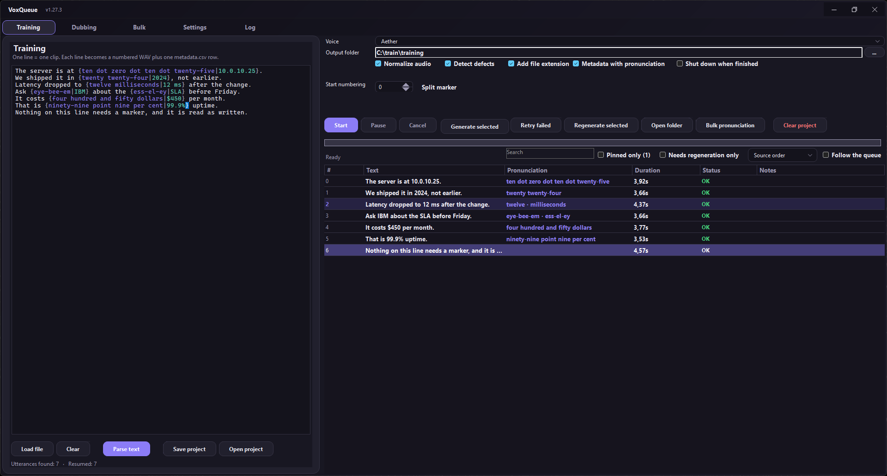

# VoxQueue

Batch text-to-speech for any OpenAI-compatible `/v1/audio` server (Piper,
VoiceStudio, and other local TTS backends).

Paste a whole script instead of one line at a time, and get back a numbered
audio dataset: clips, transcripts, and a `metadata.csv` that `piper_train`
accepts as-is.

<details>
<summary><b>Screenshot</b> — Training tab, dark theme, seven lines rendered</summary>

<br>



Every marked line shows its spoken form in a separate column: `192.168.0.1` is
read as "ten dot zero dot ten dot twenty-five", `IBM` as "eye-bee-em", the
transcript keeps the original spelling. The last line carries no marker and is
left alone — that is what an unmarked line looks like.

</details>

---

## Quick start

**Windows** — download `publish/windows/VoxQueue_1.27.3_win-x64.exe` and run it.
Nothing to install. Settings live in `%APPDATA%\VoxQueue`.

**Linux — Ubuntu / Debian** — double-click
`publish/linux/VoxQueue_1.27.3_amd64.deb`. The desktop opens its package
installer, asks for the password once, and the app appears in the application
grid with an icon. No terminal.

Or install from a shell, if you prefer:

```bash
sudo apt install ./VoxQueue_1.27.3_amd64.deb
```

**Linux — other distributions** — unpack
`publish/linux/VoxQueue-linux-x64.tar.gz` and run `./VoxQueue.sh`. A bare binary
cannot be double-clicked on any distribution: it has no name suffix, so the file
manager has no program registered for it.

From source:

```bash
python3 -m venv .venv && . .venv/bin/activate
pip install -r build/requirements.txt
python3 -m voxqueue
```

Then:

1. **Settings → Connection** — server address, default `http://127.0.0.1:3900`
2. **Refresh** — loads the voice list
3. Pick a mode, paste text (or drag a `.txt` onto the box)
4. **Parse text** — shows how many utterances the parser found
5. **Start**

The repository ships no audio — clips are large and regenerable from the text, so
`samples/` and every audio extension are ignored by git. Any text file works as
input; for a first run, paste a few lines by hand.

---

## Three modes

A mode decides **one thing**: how text is split into utterances and how files
are named. The queue, resuming, normalisation, defect detection and playback are
identical everywhere.

| Mode | Input | Output |
|---|---|---|
| **Training** | one line = one utterance | `wav/0000.wav` + `metadata.csv` |
| **Dubbing** | `NAME: dialogue` | `voices/NAME/NAME_0000_2.41s.wav` |
| **Bulk** | blocks separated by `###` | `wav/0000.wav` + `0000.txt` |

**Training** produces a Piper dataset in LJSpeech layout. `metadata.csv` has the
form `0000|text`, no header.

**Dubbing** splits on speaker prefixes. Four notations are understood:

```
ALICE: I have no time.
[BOB] Analysis complete.
CAROL — This will not work.
DAVE:
Why so serious?
```

Prose with a colon ("He said: hello") is **not** treated as a speaker: every
word after the first must start with a capital, which prose rarely satisfies.

**Bulk** splits on `###` on its own line, a triple newline, or a line of
punctuation (`====`, `----`). Each block becomes one clip plus a `.txt`
transcript beside it.

---

## Pronunciation markers

A speech engine reads characters, not meaning. The same four failures appear in
every language:

| Failure | What happens | Example |
|---|---|---|
| **Names** | read by spelling rules, not by sound | `Worcester` read "Wor-ces-ter" instead of "Wooster" |
| **Digits** | spelled one by one, or expanded with the base form of the numeral | a year in an inflected position comes out uninflected — and in languages where numerals take case, gender or an ordinal form, that is simply the wrong word |
| **Acronyms** | read letter by letter, even where the language says them as a word | `PM` becomes "P-M" |
| **Units and symbols** | read as characters instead of as words | `km/h` becomes "K-M slash H" |

The fix is to hand the engine a phonetic form while the transcript keeps the
correct spelling:

```
{wooster|Worcester}
{twenty twenty-four|2024}
{p i em|PM}
```

- **first** form goes to the engine — it is what gets spoken
- **second** form goes to `metadata.csv` and to the `.txt` transcript

In context:

```
{wooster|Worcester} is online.
We shipped it in {twenty twenty-four|2024}.
{p i em|PM} sent the report.
```

Those examples are English; the syntax is language-independent. Write the left
side the way a speaker of your language would say it, and the right side exactly
as it must appear in the transcript. The next section gives one pattern per
supported language.

### Rules

| Notation | Effect |
|---|---|
| `{spoken\|written}` | speaks the first, records the second |
| several markers in one line | each handled separately |
| `{text}` without a pipe | **stays literal** — not a marker |
| `{\|text}` or `{text\|}` with one side empty | **stays literal** — nothing is deleted |
| `{` without `}` | **stays literal** |

Malformed markers never destroy text. The written form is **inviolable**: same
inflection, same spelling, same punctuation, same capitalisation.

### Worked example — Training tab

Training mode is one line per clip: no speaker prefix, no separator. Paste these
seven lines and each becomes one utterance.

```text
The server is at {ten dot zero dot ten dot twenty-five|10.0.10.25}.
We shipped it in {twenty twenty-four|2024}, not earlier.
Latency dropped to {twelve milliseconds|12 ms} after the change.
Ask {eye-bee-em|IBM} about the {ess-el-ey|SLA} before Friday.
It costs {four hundred and fifty dollars|$450} per month.
That is {ninety-nine point nine per cent|99.9%} uptime.
Nothing on this line needs a marker, and it is read as written.
```

Press **Parse text** and the list fills with seven rows:

| # | Text (what the transcript records) | Pronunciation (what the engine says) |
|---|---|---|
| 0000 | The server is at 10.0.10.25. | ten dot zero dot ten dot twenty-five |
| 0001 | We shipped it in 2024, not earlier. | twenty twenty-four |
| 0002 | Latency dropped to 12 ms after the change. | twelve milliseconds |
| 0003 | Ask IBM about the SLA before Friday. | eye-bee-em · ess-el-ey |
| 0004 | It costs $450 per month. | four hundred and fifty dollars |
| 0005 | That is 99.9% uptime. | ninety-nine point nine per cent |
| 0006 | Nothing on this line needs a marker, and it is read as written. | — |

**Start** renders them into `wav/0000.wav` … `wav/0006.wav` beside a
`metadata.csv` in LJSpeech layout:

```text
0000|The server is at 10.0.10.25.
0001|We shipped it in 2024, not earlier.
0002|Latency dropped to 12 ms after the change.
0003|Ask IBM about the SLA before Friday.
0004|It costs $450 per month.
0005|That is 99.9% uptime.
0006|Nothing on this line needs a marker, and it is read as written.
```

The left column keeps the spelling; only the audio changes. Row 0006 shows the
point: a line without markers is left completely alone.

Try the same text in the light theme — that palette is a separate set of colours,
not an inversion, and it is the one that used to leave the editor dark.

### One pattern per language

The mechanism is the same everywhere; what changes is *which* words a given
language gets wrong. Below is one realistic failure per supported language. These
are illustrations of the shape of the problem, not a word list to copy — the
corrections that matter for your voice are the ones you hear it get wrong.

| Language | What the engine gets wrong | Marker |
|---|---|---|
| **English** | acronym read as a word instead of spelled out | `{eye-bee-em\|IBM}` |
| | unit read as characters | `{kilometres per hour\|km/h}` |
| **Polski** | numeral not inflected — "24 stycznia" needs the genitive | `{dwudziestego czwartego\|24}` |
| | acronym spelled out instead of read as letters in Polish | `{pe-ka-pe\|PKP}` |
| | currency symbol read as a character | `{sto pięćdziesiąt złotych\|150 zł}` |
| **Deutsch** | ordinal digit instead of the word | `{am dritten\|am 3.}` |
| | long number read digit by digit | `{einhundertfünfundzwanzigtausend\|125 000}` |
| **Español** | acronym read as letters where Spanish says it as a word | `{otán\|OTAN}` |
| | decimal comma read as punctuation | `{veinticinco coma cinco\|25,5}` |
| **Français** | number read digit by digit instead of the French form | `{quatre-vingt-dix\|90}` |
| | acronym read as a word instead of spelled | `{ess-en-sé-a-eff\|SNCF}` |
| **Italiano** | decimal comma read as punctuation | `{venticinque virgola cinque\|25,5}` |
| | acronym spelled as one word | `{i-enne-a-i-elle\|INAIL}` |
| **Português** | acronym spelled instead of read in Portuguese | `{i-bê-gê\|IBGE}` |
| | number read as separate digits | `{cento e vinte e cinco\|125}` |
| **Русский** | year in the genitive read in the nominative | `{две тысячи двадцать четвёртого\|2024}` |
| | acronym read as a word instead of spelled | `{эс-эн-гэ\|СНГ}` |
| **Українська** | year in the genitive read in the nominative | `{дві тисячі двадцять четвертого\|2024}` |
| | acronym read as a word instead of spelled | `{ес-ен-джи\|СНД}` |
| **Čeština** | year in the genitive read in the nominative | `{dva tisíce dvacátého čtvrtého\|2024}` |
| | acronym spelled in English letter names | `{es-en-gé\|SNG}` |
| **Slovenčina** | year in the genitive read in the nominative | `{dvetisícdvadsiateho štvrtého\|2024}` |
| | compound number split into separate words | `{stopäťdesiat\|150}` |
| **Nederlands** | compound number split into separate words | `{honderdvijfentwintig\|125}` |
| | acronym pronounced as a word | `{en-en-a\|NNA}` |
| **Svenska** | compound number split into separate words | `{etthundratjugofem\|125}` |
| | acronym read as a word instead of spelled | `{ess-se-be\|SCB}` |
| **Dansk** | number read digit by digit — Danish forms are not derivable | `{femoghalvfems\|95}` |
| **Norsk bokmål** | compound number split into separate words | `{hundreogtjuefem\|125}` |
| **Suomi** | case ending lost when the number is read | `{sadallakahdellakymmenelläviidellä\|125:llä}` |
| **Türkçe** | suffix dropped from the number | `{yüz yirmi beşinci\|125.}` |
| **日本語** | kanji read with the wrong reading, counters ignored | `{にせんにじゅうよねん\|2024年}` |
| | number read with the on reading instead of the counter form | `{ひゃくにじゅうご\|125}` |
| **中文** | year read digit by digit with the wrong tone | `{èr líng èr sì nián\|2024年}` |
| | number read without the measure word | `{yī bǎi èr shí wǔ gè\|125个}` |
| **한국어** | year read with the wrong numeral system | `{icheon isipsa nyeon\|2024년}` |
| | number in Sino-Korean where native is required | `{baek isibo\|125}` |

Two notes on using this table:

- **The written side must not be "corrected".** It is what the transcript
  records, so it keeps its original inflection, spelling and punctuation. Only the
  spoken side is yours to write freely.
- **A marker is not an escape hatch for bad text.** If the line itself is wrong,
  fix the line; the marker only changes how it is pronounced.

### Building a table for your own voice

Whether a given form is right depends on the reference voice, not on the language
in the abstract — two Polish voices disagree about reading `2024` as a
standalone number. Record what yours actually gets wrong, listening to the
output, and add a marker for each case. The mechanism above is what makes those
corrections possible; the contents of the table are yours to determine.

## Ready-to-copy prompt for an AI model

Paste this into any assistant to get a script that VoxQueue can consume directly.
Replace the language and topic as needed.

> Prepare a `.txt` file for VoxQueue import. One line = one utterance. Write in
> natural <LANGUAGE>. Wherever a speech synthesiser would read something
> incorrectly — foreign proper names, multi-digit numbers, acronyms, symbols,
> units — use the marker `{pronunciation|spelling}`, for example
> `{<how it sounds>|<how it is written>}`. The form on the right must be exactly
> what should appear in the transcript, with its original inflection, spelling
> and punctuation. Do not mark ordinary words or single-digit numbers, and do
> not mark anything the engine already reads correctly in <LANGUAGE>. Do not
> translate. Do not fix grammar in the source text. At the end, list every line
> where you were unsure of the pronunciation.

Localised versions of this instruction, with language-specific examples and a
ready-to-copy prompt in that language:

[Polski](docs/readme/README_pl.md) · [Deutsch](docs/readme/README_de.md) ·
[Español](docs/readme/README_es.md) · [Français](docs/readme/README_fr.md) ·
[Italiano](docs/readme/README_it.md) · [Português](docs/readme/README_pt.md) ·
[Русский](docs/readme/README_ru.md) · [Українська](docs/readme/README_uk.md) ·
[Čeština](docs/readme/README_cs.md) · [Slovenčina](docs/readme/README_sk.md) ·
[Nederlands](docs/readme/README_nl.md) · [Svenska](docs/readme/README_sv.md) ·
[Dansk](docs/readme/README_da.md) · [Norsk bokmål](docs/readme/README_nb.md) ·
[Suomi](docs/readme/README_fi.md) · [Türkçe](docs/readme/README_tr.md) ·
[日本語](docs/readme/README_ja.md) · [中文](docs/readme/README_zh.md) ·
[한국어](docs/readme/README_ko.md)

Those files live in `docs/readme/`. They are generated by `tools/make_readmes.py` —
edit the translation table there, not the output, or the next regeneration will
overwrite your change.

---

## Dataset for training

**From scratch you need 5–8 hours of audio minimum; aim for 8–10.** Under 5 h you
will most likely waste the training run. Fine-tuning an existing checkpoint needs
only 30–60 minutes — try that first.

Budget roughly 9000 utterances for 10 hours (about 4 s per clip). Spread them
across categories rather than using one text: phoneme coverage for your
language, numerals in every case, dates, times, units, acronyms, short and long
sentences, questions and commands, and neutral filler. A model trained on one
register only speaks that register.

**Critical:** `piper_train` phonemizes whatever `metadata.csv` contains. If the
audio was rendered from an inflected spoken form but the CSV holds the original
digits, the engine re-expands them its own way — and the model trains on phonemes
that do not match its own audio. The defect is invisible: nothing errors, the
loss just never settles. Keep **Metadata with pronunciation** on (the default)
when building a training dataset.

---

## Features

| | |
|---|---|
| **Queue** | On a worker thread, window stays responsive. Pause acts between utterances, never mid-request. |
| **Resuming** | State saved after every clip in `.voxqueue/`, so closing the app loses nothing. Re-parsing into the same output folder also picks up clips already rendered there — an interrupted night job does not start over. |
| **Pronunciation** | `{spoken\|written}` markers — see above. |
| **Pronunciation column** | Shows only the substituted words, in accent colour. |
| **Projects** | Save and reopen a session as `.vqproj`. |
| **Single clip** | "Generate selected" renders only the selected rows. |
| **Shutdown** | Optionally powers the machine off when the run finishes, after a 60-second countdown with a Cancel button. Never on a cancelled run, never when nothing was rendered. |
| **Follow the queue** | Scrolls the work list to the row being processed, so a long run can be watched live. A checkbox next to the status line, togglable mid-run and remembered between sessions. |
| **Buttons always fit** | The button row wraps instead of clipping. At a narrow window the buttons move onto a second line rather than disappearing off the right edge. |
| **Sort order** | Source order, errors first, or pronunciation first. A thousand finished clips would otherwise bury the dozen that need attention. The selection survives a re-sort, so "regenerate selected" never hits the wrong clip. |
| **Edit pronunciation** | Right-click a row to change how the engine says it. The edit is written back into the source text, so the next parse does not undo it, and only the line that changed is repainted. The Pronunciation column shows the words that differ, not the whole sentence. |
| **Search** | A box above the list filters as you type, matching the text, the pronunciation, the speaker or the clip number. |
| **Bulk pronunciation** | Replace a phrase everywhere at once. Three fields: what to find, how the engine should say it, what the transcript should keep. "Count matches" runs first and Replace stays disabled until the count proves it will do something. Markers already in the text are rewritten in place — searching the phonetic form `i-de` and asking for `ajdi` turns `{i-de\|ID}` into `{ajdi\|ID}`, written side untouched. Leaving "Written as" empty keeps each marker's own spelling. |
| **Re-parse guard** | Processing the text again rebuilds the list and resets every clip, so it asks first when there is rendered work to lose, and says so without a dialog when the list already matches the text. |
| **Stale tracking** | A clip rendered before its line was edited shows `~` and a blue tint instead of `OK` — the audio on disk no longer matches the text. Rows stay in the "needs regeneration" list while queued, while running and after a failure; only a successful render removes them. The sort menu can lift them to the top. |
| **Colouring switch** | Settings → Appearance can turn syntax colouring off entirely, which is the cheapest way to speed up work on very large scripts. Switching tabs no longer restarts the pass. |
| **Log tab** | Everything the app did — connections, parses, edits, saves — with buttons to open the file, copy it, or clear it. |
| **Session restore** | Closing the window keeps all three tabs — list, text, options and every clip's status — plus the tab that was open. "Clear project" is the one action that discards a tab's session. |
| **Drop a project** | Drag a `.vqproj` onto the window — a border and caption appear while it hovers. It opens in the tab matching its mode, and asks before replacing what is already there. |
| **Pin and filter** | Right-click to pin the selected rows; a filter shows only pinned ones, with the count on the label so an empty list is explained. Pins survive a restart. |
| **Jump to index** | Right-click to jump to a row by its number, matched against the item's own index rather than its row position — the two differ once a sort is applied. |
| **Large scripts** | Parsing runs off the UI thread and colouring runs in slices over the whole document, with redraw suspended per slice and the text snapshotted once per pass. A badge shows progress; parsing stays available throughout, because colouring is decoration and the text is already final. The editor does not wrap, so a long line gets a horizontal scrollbar instead of running off the edge. |
| **Row state at a glance** | Failed rows are tinted red, flagged rows amber, pinned rows violet. A failed row keeps its red even when it is pinned. |
| **Voice memory** | The last selected voice is remembered across sessions, including across an offline start where the voice list is empty. |
| **Normalisation** | `ffmpeg loudnorm` to −16 LUFS, with a peak fallback when ffmpeg is missing. |
| **Defect detection** | 9 types: clipping, click at the end, beep, pop, too short, silence, DC offset, loud tail, too long for the text. Clips are **flagged, not deleted**. |
| **Playback** | Double-click a row. The built-in player reads the format from the file header, so extensionless files play too. While a clip plays, the progress bar shows its position with a `0:01 / 0:04` clock; when it ends the bar goes back to queue progress. |
| **File extension** | Optional. Off gives bare `0000` names, matching the Piper docs. Only offered for WAV. |
| **Lock while running** | Only Pause and Cancel stay enabled during a run. |
| **Languages** | 20, switched live without restart; system language by default. |
| **Theme** | Dark, light, or system. |

---

## Build

```bash
# Windows, cross-compiled from Linux (Docker + dotnet sdk 10)
bash dotnet/build-win.sh

# Linux (PyInstaller)
python3 -m venv .venv && . .venv/bin/activate
pip install -r build/requirements.txt pyinstaller
bash build/build_linux.sh
```

Both scripts run the tests first and abort on failure, so a broken build is
never published.

---

## Architecture

```
dotnet/src/                 C# / WinForms
├── VoxQueue.Core/          net10.0            logic, no UI
│   ├── Models/Models.cs      Job, ItemRow, options
│   └── Services/
│       ├── AppLog.cs           the log the Log tab shows
│       ├── Config.cs           settings in %APPDATA%
│       ├── TextSplitter.cs     three parsers + filename sanitising
│       ├── Pronunciation.cs    reading {spoken|written}
│       ├── PronunciationEdit.cs  rewriting and counting markers
│       ├── RegenTracker.cs     which rows a re-parse invalidated
│       ├── JobView.cs          filtering and ordering the list
│       ├── TtsClient.cs        OpenAI-compatible client
│       ├── AudioTools.cs       WAV, normalisation, defect detection
│       ├── JobRunner.cs        queue, filenames, metadata.csv
│       ├── PowerAction.cs      shutdown, cancellable
│       ├── WorkspaceFile.cs    .vqproj projects
│       └── SafeFile.cs         retrying writes (file locks)
├── VoxQueue.Desktop/       net10.0-windows    WinForms
└── VoxQueue.SelfTest/      net10.0            console tests

voxqueue/                   Python / Qt — same feature set
├── core/                   pronunciation, workspace, splitter, worker, audio
└── ui/                     work_tab, settings_tab, widgets, theme
```

`VoxQueue.Core` is deliberately **not** `net10.0-windows`: it compiles and tests
on Linux, where WinForms cannot run. That is how the logic gets verified before
a package is handed over.

Both implementations carry the same features. The C# side has 33 self-test
checks, the Python side 28 — the Python build checks less of the geometry because
Qt reports layout honestly and WinForms does not.

### Why some controls are hand-drawn

| Control | Problem | Solution |
|---|---|---|
| `ComboBox` | drawn by the OS theme, ignores `BackColor` — stayed black in light mode | `Dropdown` — paints fill, text and chevron itself |
| `AutoScroll` bar | system-drawn, always light | `ScrollHost` — scrolls and paints the thumb |
| `NumericUpDown` | its spin buttons are a native child painted by the OS, so they stayed black on a white field | `FlatNumber` — draws the field and both arrows; the wheel only works with focus |
| `ProgressBar` | once `ForeColor` is set it drops the themed renderer and animates its own fill | `FlatProgress` — draws a track and a filled rectangle, no timer |

### Numbering

Always from `0000`, on every launch. The "Start numbering at" field changes the
current session only and is **not persisted** — a value nudged once by the wheel
used to leak into the next dataset.

---

## Tests

```bash
# logic — any platform
dotnet run --project dotnet/src/VoxQueue.SelfTest/VoxQueue.SelfTest.csproj
python3 run.py --selftest

# packaged binaries
publish\windows\VoxQueue_1.27.3_win-x64.exe --selftest
publish/linux/VoxQueue --selftest
```

The checks assert behaviour, not the presence of code. Each one exists because the
corresponding bug shipped:

| Area | What is asserted |
|---|---|
| Markers | the reported case: ten edited pronunciations must mark ten rows stale, and the written form must survive |
| Written form | leaving the field alone keeps the spelling found in the text |
| Retry | failed and stale rows are both re-queued; a finished row is not |
| Stale lifetime | a row stays listed while queued, while running and after a failure; only success removes it |
| WAV duration | a real file is written and measured within 10 ms at three lengths |
| Filters | pin, stale and search combine, and no filter returns everything on a miss |
| Translations | every key resolves in all 20 languages, no key defined twice, Polish differs from English |
| Geometry | no control taller than its row, no table whose rows overflow it, every caption fits its button |
| Widget tree | every settings control is really in the window — a combo that is built and wired but never added is invisible |
| Language switch | every caption on the settings and work pages changes — labels, checkboxes and buttons, not just labels |
| System language | the "System" entry exists, is first, is selected by default, and is translated |
| Parenting | the editor is really added to its container, and the progress strip is not a native `ProgressBar` |

The geometry checks are the ones that catch what reading the code cannot: a control
parented correctly but drawn outside its cell looks fine in the source and wrong on
screen.

`build-win.sh` also has a guard that fails the build when `SplitterDistance` or
`PanelXMinSize` is set to a numeric literal — a `SplitContainer` is 150 px wide
when constructed, and that assignment throws before any window exists.

---

## Version

There is no runtime version endpoint; the number is baked into each artefact at
build time and is the same in all three:

| Where | What to look at |
|---|---|
| Window title bar | `v1.27.3` |
| `VoxQueue_1.27.3_win-x64.exe` | the file name itself |
| inside the exe | right-click → Properties → Details → File version |
| `VoxQueue_<version>_amd64.deb` | `dpkg -f ... Version` |

Both artefact names carry it, so two builds cannot be confused after a download.
The Windows executable used to be plain `VoxQueue.exe` with the number visible only
inside the window. Now the file name carries it, and `FileVersion` and
`InformationalVersion` in the project file put it into the binary's own metadata
as well.

---

## Requirements

- **Windows 10/11 x64** — self-contained `.exe`, no runtime needed
- **Linux x64** — glibc 2.33 or newer. Nothing else: the xcb libraries Qt needs
  are bundled inside the binary, so the `.deb` pulls no dependencies. Built
  against the Ubuntu 22.04 library versions, which is why 22.04 and newer both
  work.
- **ffmpeg** — optional. Without it, WAV and all defect detection work;
  MP3/M4A/OGG/FLAC and `loudnorm` need it.

---

## Licence

Application code: MIT — see [LICENSE](LICENSE).

**The voice model you synthesise with has its own licence.** VoiceStudio with
OmniVoice is non-commercial (CC-BY-NC); Piper is permissive. Clone a voice only
with the owner's consent.
